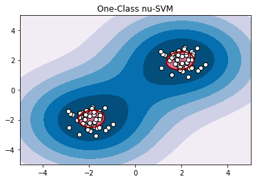
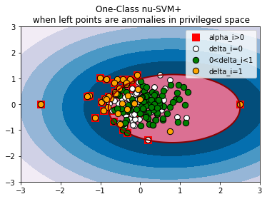

# OCSVM+: One-Class SVM with Privileged Information

OCSVM+ is a Cython implementation of a one-class support vector machine with privileged information.
It extends the standard one-class `nu`-SVM to the LUPI setting, where additional features are available during training but are not available at prediction time.
The model learns the decision boundary in the original feature space and uses the privileged feature space only through the training-time correcting function.

The implementation accompanies the IEEE Access article:

> A. Lange, D. Smolyakov, and E. Burnaev, "Sequential Minimal Optimization Algorithm for One-Class Support Vector Machines With Privileged Information," *IEEE Access*, vol. 11, pp. 128106-128124, 2023, doi: 10.1109/ACCESS.2023.3331685.

Article link: https://ieeexplore.ieee.org/document/10314493

## Method illustration

The two figures below illustrate the synthetic experiment discussed in the paper.
The original observations live in a two-dimensional decision space.
In the paper, the base cloud is described as a sample from a two-dimensional standard normal distribution, augmented with two artificial outliers.
During training, each observation also has one extra privileged feature `x_star`.
This third coordinate is not used when predicting new samples; it is available only to guide the training procedure.

The privileged coordinate is constructed as a teacher's hint about which part of the original space should look more anomalous.
For points to the right of the origin, `x_star` is an ordinary small value drawn near zero, from a normal distribution with standard deviation `0.1`.
For points to the left of the origin, `x_star` has a large magnitude and is drawn far from zero.
Thus, in the privileged space, left-side points look much more suspicious than right-side points, although the final domain boundary must still be drawn only in the original two-dimensional feature space.

A standard one-class `nu`-SVM sees only the two original coordinates, so it learns a domain around the Gaussian cloud without this additional hint.
OCSVM+ receives the training-time signal that the left-side points are more anomalous.
It transfers this information from the privileged space to the original decision space: the accepted domain shifts to the right, and many left-side points that would remain inliers for ordinary OC-SVM become outliers.
The strength of this shift is controlled by the privileged regularization parameter `gamma` and the privileged-kernel parameter: smaller values make the privileged signal more influential.

<table>
  <tr>
    <td align="center" width="50%">
      
    </td>
    <td align="center" width="50%">
      
    </td>
  </tr>
  <tr>
    <td align="center"><em>Standard one-class <code>nu</code>-SVM: the boundary is learned only from the original two-dimensional features.</em></td>
    <td align="center"><em>OCSVM+: the training-time privileged feature marks left-side points as more anomalous, so the learned domain moves to the right.</em></td>
  </tr>
</table>

## Main features

- One-class SVM with privileged information (OCSVM+) for anomaly and novelty detection.
- Sequential Minimal Optimization (SMO) solver for the OCSVM+ dual problem.
- CVXOPT-based interior-point solver for comparison experiments.
- Separate kernels for original and privileged features.
- Basic scikit-learn estimator interface: `fit`, `decision_function`, `predict`, and use in `GridSearchCV` with an explicit scoring function.
- Kernel and distance caching options for performance experiments.

## Installation

Clone or download the repository, then build the Cython extension in place from the repository root:

```bash
python -m pip install numpy scikit-learn Cython cvxopt
python setup.py build_ext --inplace
```

The current module imports CVXOPT at import time, so CVXOPT should be installed even if only the SMO solver is used.

The Cython module uses the STLCACHE C++/Cython declarations for caching kernel values.
The file `stlcache.pxd` includes the C++ header as `stlcache/stlcache.hpp`; therefore the STLCACHE headers should be available in this layout relative to the repository root, or through an equivalent compiler include path:

```text
stlcache.pxd
stlcache/stlcache.hpp
stlcache/policy.hpp
stlcache/policy_lru.hpp
stlcache/policy_lfu.hpp
stlcache/victim.hpp
stlcache/exceptions.hpp
```

After a successful build, the module can be imported as follows:

```python
from ocsvm_plus import OneClassSVM_plus
```

### Tests

The `tests.py` file targets the debug module `ocsvm_plus_debug`.
The debug build script builds both `test_stlcache` and `ocsvm_plus_debug`, so run it before the unit tests:

```bash
python setup_debug.py build_ext --inplace
python -m unittest tests
```

The debug build performs additional assertions and consistency checks and is expected to be much slower than the release build.

## Quick start

`fit` expects a single matrix whose first `n_features` columns are the original features and whose remaining columns are the privileged features.
After fitting, `decision_function` and `predict` need only the original features.

```python
import numpy as np
from ocsvm_plus import OneClassSVM_plus

rng = np.random.RandomState(0)

# Original features available both at training and prediction time.
X = 0.5 * rng.randn(200, 2)
X[-2:, :] = [[-2.5, 0.0], [2.5, 0.0]]

# Privileged features available only during training.
left = X[:, 0] < 0
X_star = np.empty((X.shape[0], 1))
X_star[~left] = 0.1 * rng.randn((~left).sum(), 1)
X_star[left] = (2.0 * rng.rand(left.sum(), 1) - 1.0) * 100.0
X_star[left] += 10.0 * np.sign(X_star[left])

X_train = np.hstack((X, X_star))

model = OneClassSVM_plus(
    n_features=2,
    nu=0.5,
    gamma=0.1,
    kernel_gamma=0.1,
    kernel_star_gamma=0.1,
)
model.fit(X_train)

scores = model.decision_function(X)  # positive means inlier, negative means outlier
labels = model.predict(X)            # +1 for inliers, -1 for outliers
# The correcting function is a training-time diagnostic, because X_star is
# not assumed to be available for new prediction-time samples.
corrections = model.correcting_function(X_star)

print(scores[:5])
print(labels[:5])
```


## API

```python
class ocsvm_plus.OneClassSVM_plus(
    n_features,
    kernel='rbf',
    kernel_gamma='scale',
    kernel_star='rbf',
    kernel_star_gamma='scale',
    nu=0.5,
    gamma='auto',
    alg='best_step_2d',
    tau=0.001,
    ff_caches='not_bound',
    kernel_cache_size=0,
    distance_cache_size=0,
    max_iter=-1,
    random_seed=None,
    logging_file_name=None,
)
```

### Parameters

| Parameter | Description |
| --- | --- |
| `n_features` | Number of original features. The remaining columns passed to `fit` are treated as privileged features. |
| `kernel` | Kernel for original features. Supported values are `'rbf'`, `'linear'`, or a custom class derived from `ocsvm_plus.kernel`. Default: `'rbf'`. |
| `kernel_gamma` | RBF coefficient for `kernel`. Use `'scale'`, `'auto'`, or a positive float. For `'scale'`, the value is `1 / (n_features * X.var())`; for `'auto'`, it is `1 / n_features`. Default: `'scale'`. |
| `kernel_star` | Kernel for privileged features. Supported values are `'rbf'`, `'linear'`, or a custom class derived from `ocsvm_plus.kernel`. Default: `'rbf'`. |
| `kernel_star_gamma` | RBF coefficient for `kernel_star`. Use `'scale'`, `'auto'`, or a positive float. For `'scale'`, the value is `1 / (n_features_star * X_star.var())`; for `'auto'`, it is `1 / n_features_star`. Default: `'scale'`. |
| `nu` | One-class SVM regularization parameter. Must satisfy `0 < nu < 1`. Default: `0.5`. |
| `gamma` | Regularization parameter for the privileged-feature correcting function. Use `'auto'` or a positive float. For `'auto'`, the value is `nu * n_samples`. Default: `'auto'`. |
| `alg` | Optimization algorithm. Supported values are `'best_step_2d'`, `'best_step'`, `'delta_pair'`, and `'cvxopt'`. Default: `'best_step_2d'`. |
| `tau` | Stopping tolerance for SMO algorithms. Default: `0.001`. Ignored by `alg='cvxopt'`. |
| `ff_caches` | Cache rule for maintaining current values of the decision and correcting functions. Supported presets are `'all'`, `'not_bound'`, and `'not_zero'`; a low-level dictionary form is also accepted. Default: `'not_bound'`. |
| `kernel_cache_size` | LRU cache size for kernel values. If `0`, kernel values are stored in triangular matrices after first calculation. Default: `0`. |
| `distance_cache_size` | LRU cache size for pairwise distance-like values used in SMO steps. If `0`, values are stored in triangular matrices after first calculation. Default: `0`. |
| `max_iter` | Maximum number of SMO iterations. Use `-1` for no hard iteration limit. Default: `-1`. |
| `random_seed` | Random generator seed used for repeatable initialization in tests and experiments. Default: `None`. |
| `logging_file_name` | Optional log file name. Use `None` to disable logging, `'uuid'` for a generated UUID-based filename, or `'time'` for a timestamp-based filename. Default: `None`. |

### Algorithms

- `alg='best_step_2d'`: the default SMO variant. It selects the most violating pair and may apply a two-dimensional update when both original and privileged coefficient-pair conditions are involved.
- `alg='best_step'`: selects the most violating alpha or delta pair and performs a one-dimensional update.
- `alg='delta_pair'`: prioritizes delta-pair updates and then alpha-pair updates; this option is usually slower.
- `alg='cvxopt'`: uses the general-purpose CVXOPT quadratic-programming solver. It is intended mainly for comparison and testing, not for large-scale runs.

### Attributes

| Attribute | Description |
| --- | --- |
| `alphas_` | Dual coefficients `alpha_i`. |
| `deltas_` | Dual coefficients `delta_i`. |
| `rho_` | Decision-function intercept. |
| `b_star_` | Correcting-function intercept. |
| `alpha_support_` | Indices of training examples with `alpha_i > 0`. |
| `delta_support_` | Indices of training examples with `0 < delta_i < 1`. |
| `fit_status_` | `True` when the fitted model has the support structure needed to compute the standard intercepts from non-bound coefficients. If it is `False`, consider decreasing `tau` and/or increasing `max_iter`. |

### Methods

| Method | Description |
| --- | --- |
| `fit(Xall, y=None)` | Fits the model. `Xall` has shape `(n_samples, n_features + n_features_star)`. The first `n_features` columns are original features; the remaining columns are privileged features. `y` is ignored and is accepted only for scikit-learn compatibility. |
| `decision_function(X)` | Returns signed distances in the original feature space. Positive values correspond to inliers and negative values to outliers. If `X` has extra columns, only the first `n_features` columns are used. |
| `predict(X)` | Returns `+1` for inliers and `-1` for outliers. |
| `correcting_function(X_star)` | Returns the values of the training-time correcting function in the privileged feature space. If `X_star` has extra columns, only the last `n_features_star` columns are used. |

## Experiments notebook

The exploratory notebook `experiments.ipynb` contains the synthetic example, hyperparameter studies, Shuttle data experiments, and comparisons with CVXOPT.
The current API selects the solver through the `alg` parameter: use `alg='best_step_2d'` for the default SMO solver and `alg='cvxopt'` for the CVXOPT comparison solver.

The notebook also expects external experiment files such as `shuttle.mat` and generated pickle files for cached results.

## Citation

If you use this code or the OCSVM+ algorithm in academic work, please cite:

```bibtex
@ARTICLE{10314493,
  author={Lange, Andrey and Smolyakov, Dmitry and Burnaev, Evgeny},
  journal={IEEE Access}, 
  title={Sequential Minimal Optimization Algorithm for One-Class Support Vector Machines With Privileged Information}, 
  year={2023},
  volume={11},
  number={},
  pages={128106-128124},
  keywords={Support vector machines;Kernel;Optimization;Training;Data models;Predictive models;Task analysis;Anomaly detection;Knowledge transfer;Information analysis;Anomaly detection;kernel methods;knowledge transfer;LUPI;one-class SVM;privileged information;sequential minimal optimization;SMO;support vector machines;SVM+},
  doi={10.1109/ACCESS.2023.3331685}}
```

## Third-party software

This project uses the STLCACHE library for caching kernel-function values.
Many thanks to the STLCACHE authors: https://github.com/akashihi/stlcache

When vendoring STLCACHE into this repository, keep the C++ headers under the `stlcache/` directory, because `stlcache.pxd` refers to `stlcache/stlcache.hpp`.
